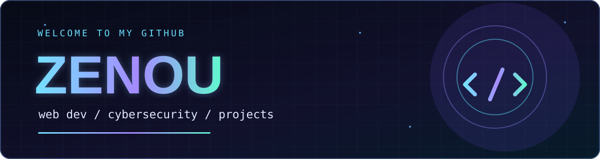

 

---

# 💫 About Me:

I'm currently working on **Zenou Unblocked**, my own unblocked games website.

I'm currently learning more about coding, web development, cybersecurity and how to use AI to build stuff.

You can ask me about my website, vibe coding or anything tech related.

I go by **Zenou** online and mostly build random stuff for fun. More projects coming soon.

# 💻 Tech Stack:

**Languages & Markup**

**Frontend Development**

**Backend & Cloud**

**Developer Tools & Testing**

**Design**

# 📊 GitHub Stats:

---

